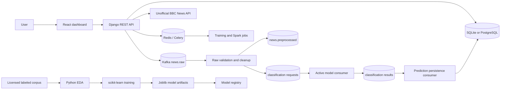
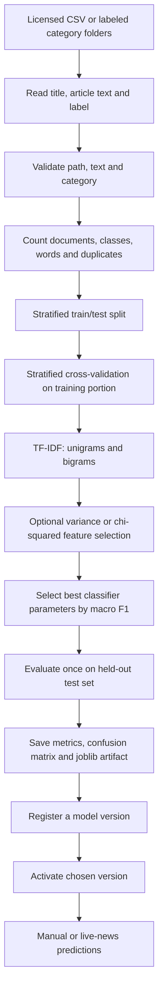
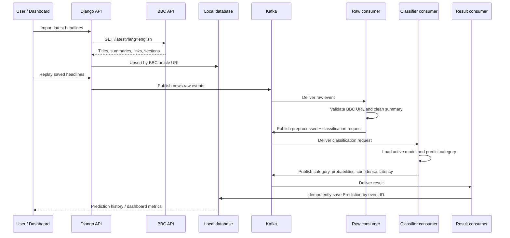

# News Intelligence

**Created by Yahya Bouchak**
Local development project for BBC news ingestion, big data exploration, machine learning and live event processing.

News Intelligence is a full-stack application. A React dashboard calls a Django API. The API stores news snapshots and experiment metadata in SQLite (or optional PostgreSQL), queues longer jobs with Celery and Redis, and can publish saved BBC summaries to Kafka for classification. Python/scikit-learn handles supervised text classification; PySpark provides batch EDA and LDA topic modelling.

> **Data note:** the live feed uses an independent, unofficial BBC News API. It returns headline metadata and summaries; it is not the BBC, may change or be unavailable, and does not provide a guaranteed full article body or publication time. The project's historical five-class labels are `business`, `entertainment`, `politics`, `sport`, and `tech`. Live classifier predictions are model inferences, not BBC editorial labels.

## Table of contents

1. [Features](#features)
2. [Architecture and data flow](#architecture-and-data-flow)
3. [Requirements](#requirements)
4. [Install from a clean checkout](#install-from-a-clean-checkout)
5. [Run the complete local stack](#run-the-complete-local-stack)
6. [Backend API](#backend-api)
7. [Big data and ML workflow](#big-data-and-ml-workflow)
8. [Import current BBC news](#import-current-bbc-news)
9. [Kafka live classification](#kafka-live-classification)
10. [Dashboard guide](#dashboard-guide)
11. [Configuration](#configuration)
12. [Database and generated files](#database-and-generated-files)
13. [Docker Compose services](#docker-compose-services)
14. [Troubleshooting](#troubleshooting)
15. [Validation and current limits](#validation-and-current-limits)
16. [GitHub publishing](#github-publishing)
17. [Project structure](#project-structure)
18. [Further documentation](#further-documentation)

## Features

- Import labeled historical articles from category folders or CSV and calculate dataset EDA.
- Run Spark SQL EDA and Spark MLlib LDA topic modelling.
- Train majority baseline, Multinomial Naive Bayes, or KNN text classifiers with TF-IDF and optional feature selection.
- Compare experiments, register model versions, activate a version, and classify text through the API.
- Fetch and save current BBC headline metadata and summaries on demand.
- Replay saved live summaries to Kafka, clean and classify events, store predictions, and route invalid messages to dead-letter topics.
- Use the React dashboard to explore the dataset, launch jobs, inspect models and predictions, and monitor services.

## Architecture and data flow



### End-to-end request flow

1. The dashboard sends HTTP requests to Django on port `8000`.
2. Django validates inputs, reads or writes the configured database, and returns JSON.
3. Live import calls the configured BBC metadata API, validates BBC links and saves one row per article URL. Re-importing a URL updates the saved snapshot.
4. Dataset EDA reads the local labeled corpus. Training creates an experiment record and queues a Celery task; the worker writes metrics and a model artifact.
5. A successful experiment can be registered and activated. Manual predictions and Kafka classifications use the active version.
6. Kafka replay sends saved summaries to `news.raw`. Consumers validate and clean text, request a prediction, publish a result, and save it in prediction history. Invalid messages go to a dead-letter topic.

The detailed component diagram and data boundaries are in [docs/architecture.md](docs/architecture.md).

### Dataset-to-model workflow



The top branch describes the data preparation and training path. The holdout test set is kept outside the cross-validation search: CV tunes parameters using only the training data, and the final metrics are calculated on the held-out portion. Since TF-IDF and feature selection are steps inside the scikit-learn pipeline, they are fitted within each CV fold to avoid learning vocabulary from that fold's validation documents.

### How a live article becomes a saved prediction



The history of each item has distinct stages: the upstream response creates or refreshes a `LiveNewsItem`; the replay creates Kafka events; the final result consumer creates a `Prediction`. Importing current news does not itself classify it. Kafka replay and the three consumers are separate actions so each stage can be inspected.

## Requirements

- macOS, Linux, or Windows with WSL2.
- Python 3.12 recommended for the pinned Python stack.
- Node.js and npm for the dashboard.
- Docker Desktop / Docker Engine with Compose v2 for Redis and Kafka.
- Java 21 and a compatible Spark installation for Spark jobs. The installed stack in the development environment used Spark/PySpark 4.2.
- A labeled news dataset for supervised training. No historical article corpus is committed here.

SQLite is the default database and requires no extra service. PostgreSQL is optional. Redis is needed for queued model/topic jobs. Kafka is only needed for the streaming classification flow.

## Install from a clean checkout

Run these commands from the repository root (`news-intelligence/`):

```sh
python3.12 -m venv .venv
source .venv/bin/activate
python -m pip install --upgrade pip
python -m pip install -r requirements.txt
cp .env.example .env
npm --prefix frontend install
```

Edit `.env` and set a private random `DJANGO_SECRET_KEY`. The `.env` file is ignored by Git. Never commit API credentials, local database files, downloaded news datasets, or generated models.

If the `python` command is not found before venv activation, use `python3.12` to create the environment, then activate it with `source .venv/bin/activate`. After activation, `python` should point into `.venv`.

## Run the complete local stack

### 1. Start infrastructure

Docker Desktop/Engine must be running first. From the project root:

```sh
docker compose up -d redis kafka kafka-ui
docker compose ps
```

Kafka UI is at [http://localhost:8080](http://localhost:8080). PostgreSQL is optional; start it with `docker compose up -d postgres` if you configured `DATABASE_URL`.

### 2. Start the backend API

In a new terminal from the project root:

```sh
source .venv/bin/activate
cd backend
python manage.py migrate
python manage.py runserver
```

The API is at [http://127.0.0.1:8000](http://127.0.0.1:8000). Health check: `/api/v1/system/health/`. Swagger API docs: `/api/docs/`.

### 3. Start background jobs (when needed)

For training and Spark LDA requests, keep Redis running and start a worker in another terminal:

```sh
source .venv/bin/activate
cd backend
celery -A config worker --loglevel=INFO --pool=solo
```

Use the foreground `train_model` management command when you want to train without Celery.

### 4. Start the dashboard

In another terminal from the project root:

```sh
cd frontend
npm run dev
```

Open the local URL printed by Vite (normally [http://localhost:5173](http://localhost:5173)). The frontend talks to the local Django API.

### Stop services

Stop foreground API, Celery, and Vite terminals with `Ctrl+C`. Stop Docker containers while keeping their local volumes:

```sh
docker compose down
```

To also delete local Postgres, Redis, and Kafka data volumes, run `docker compose down -v`. **This permanently deletes the data in those Docker volumes.**

## Backend API

Django project code lives under `backend/`; reusable data and ML code lives at the repository root in `bigdata/` and `streaming/`. The main app responsibilities are:

- `apps.datasets`: dataset summary and article preview/search.
- `apps.newsfeed`: BBC API client, URL checks, live feed model, importer, and live-feed routes.
- `apps.experiments`: experiment/model/prediction/topic-run models, training and prediction routes, model registry, background tasks, and Kafka management commands.
- `apps.system_monitoring`: health checks, service probes, active-job list, and stream status/replay routes.

### Main routes

| Purpose | Method and route |
|---|---|
| Health | `GET /api/v1/system/health/` |
| Service checks | `GET /api/v1/system/services/` |
| Active jobs | `GET /api/v1/system/jobs/` |
| Dashboard summary | `GET /api/v1/dashboard/overview/` |
| Dataset summary/articles | `GET /api/v1/datasets/summary/`, `GET /api/v1/datasets/articles/` |
| BBC live snapshot | `GET /api/v1/news/live/?lang=english&limit=50` |
| Import latest BBC snapshot | `POST /api/v1/news/live/import/?lang=english` |
| Preprocess text | `POST /api/v1/pipelines/preprocess/` |
| Queue classifier training | `POST /api/v1/experiments/train/` |
| List/compare experiments | `GET /api/v1/experiments/`, `GET /api/v1/experiments/compare/` |
| Register experiment model | `POST /api/v1/experiments/{id}/register/` |
| Browse/activate models | `GET /api/v1/models/`, `GET /api/v1/models/active/`, `POST /api/v1/models/{id}/activate/` |
| Predict text | `POST /api/v1/predictions/classify/` |
| Prediction history | `GET /api/v1/predictions/` |
| Queue Spark topics | `POST /api/v1/analytics/topics/run/` |
| Kafka status/replay | `GET /api/v1/system/streaming/`, `POST /api/v1/system/streaming/replay/` |
| OpenAPI schema / Swagger | `GET /api/schema/`, `GET /api/docs/` |

JSON POST requests use the browser's Django CSRF cookie/token flow. Local development has debug enabled; configure secure settings, authentication/authorization, HTTPS and secret management before exposing any service beyond localhost.

## Big data and ML workflow

### Dataset format

Supply your own dataset (the BBC text is not distributed in this repository). Either use category subfolders, with one article per `.txt` file:

```text
datasets/raw/
  business/article-001.txt
  entertainment/article-001.txt
  politics/article-001.txt
  sport/article-001.txt
  tech/article-001.txt
```

Or supply a CSV with a label/category column and one text column named `content`, `text`, `article`, or `body`. You can point `BBC_DATASET_PATH` in `.env` to a different relative or absolute path. The command reports a clear error when the path is missing or no labeled articles can be read.

Dataset source licenses apply; the original BBC retains copyright to its article text. Use only data you are entitled to process and keep downloaded corpus files out of Git.

### Run Python ingestion and EDA

From repository root, with `.venv` active:

```sh
python -m bigdata.cli datasets/raw --output datasets/exports/eda.json
```

This validates the dataset, reads category labels and text, and writes article counts, per-category counts, vocabulary and related EDA statistics. Data paths under `datasets/` are ignored by Git.

The EDA result is a report, not a newly fabricated training corpus. Each accepted document keeps its text and category label in memory for that command or training run. Stable document IDs are hashes of title and content, which helps identify duplicates. Empty or unlabeled CSV rows are skipped; unsupported/missing datasets fail with a clear error. For folders, only `.txt` documents under the five supported class directories are included.

### Train a supervised classifier

Start the backend and Celery worker, then use **Model training** in the dashboard. This is the training lifecycle:

1. The API checks the selected algorithm, feature selector, numeric settings and dataset path.
2. Django inserts an `Experiment` row with `queued` state and the selected configuration.
3. Celery changes it to `running`, reads labeled articles and creates title-plus-content inputs and category labels.
4. A deterministic stratified split creates an 80% training partition and 20% held-out test partition by default (the random seed is configurable).
5. A pipeline cleans text, builds English-stopword-filtered TF-IDF unigram/bigram features, optionally selects features, and applies the classifier.
6. Stratified CV (five folds by default, reduced when a class is small) evaluates candidate parameters using macro F1. For Naive Bayes, alpha is searched over 0.5, 1.0 and 1.5; for KNN, neighbors are 3, 5 and 7. Baseline uses the most frequent class.
7. The best pipeline is evaluated on the held-out test data. The app records accuracy, macro precision/recall/F1, per-class report, confusion matrix, run duration and feature counts.
8. The fitted scikit-learn pipeline is serialized as a joblib artifact. The experiment becomes succeeded or failed and the result appears in the dashboard.
9. A human selects a successful run to register, then activates a registered version. Prediction endpoints load only the active model within the configured artifact directory.

The experiment is persisted with status, configuration, metrics, confusion matrix, and artifact path. Register the successful experiment in **Experiment history** and activate its model version in **Model registry** before calling prediction or Kafka classification.

Available algorithms are majority baseline, Multinomial Naive Bayes, and KNN. The text pipeline includes cleanup and TF-IDF vectorization; supported selectors are none, variance, and chi-squared. Metrics include classification reports and macro F1. A synchronous CLI example from `backend/`:

```sh
python manage.py train_model --algorithm naive_bayes --selector none
```

Artifacts are written to `ml_artifacts/` and are not committed. Only activate artifacts created from trusted training code and datasets.

### Spark analytics and topics

For Spark EDA, configure Java and PySpark, then from repository root:

```sh
export JAVA_HOME="$(/usr/libexec/java_home -v 21)"
export PYSPARK_PYTHON="$(pwd)/.venv/bin/python"
spark-submit bigdata/spark_cli.py datasets/raw --output datasets/exports/spark_eda.json
```

For topic modelling, start the Celery worker with a working Spark/JDK runtime and choose **Features & topics** in the dashboard. The API queues a Spark MLlib LDA job; status/results are saved as a topic run. The fact that PySpark is installed does not itself mean that a Spark job completed; inspect the job status and worker logs.

## Import current BBC news

The integration calls the configured third-party API (`BBC_NEWS_API_URL`, default `https://bbc-news-api.vercel.app`) to fetch the latest metadata. It validates article links, deduplicates by URL, and stores title, summary, image, sections, language and the time this app fetched the snapshot. No full article scraping is performed.

Manual import from `backend/`:

```sh
python manage.py import_bbc_live --language english
```

Or open **BBC Live Feed** and select **Import latest**. The import is on demand; it does not imply a push feed, websocket, or automatic scheduler. Network/DNS and upstream API availability are required.

## Kafka live classification

Kafka runs in single-node local KRaft mode for development. Start Docker services and confirm `docker compose ps` shows Kafka healthy. Import headlines and train/register/activate a model first.

Create the configured topics from `backend/`:

```sh
source ../.venv/bin/activate
python manage.py create_kafka_topics
```

Open three backend terminals and run one consumer in each:

```sh
python manage.py run_kafka_consumer raw
```

```sh
python manage.py run_kafka_consumer classify
```

```sh
python manage.py run_kafka_consumer results
```

Then use the **Streaming** dashboard page and press **Replay saved BBC items**. This publishes saved summaries to `news.raw`; the consumers process each stage and save predictions in Prediction history. Kafka groups commit offsets only after downstream delivery. Bad or unusable events are routed to `news.raw.dlq` or `news.classification.dlq`. The UI displays broker/topic reachability, handled records, saved predictions and dead-letter totals. It does not claim active consumer counts or throughput metrics.

Topic stages: `news.raw` → `news.preprocessed` and `news.classification.requests` → `news.classification.results`. Additional analytics/system topics are reserved. This single-broker Compose setup is for local development and has no broker redundancy.

## Dashboard guide

- **Overview:** dataset, active model, experiments, saved live items and prediction summary.
- **Dataset explorer:** search/browse available labeled articles and category distribution.
- **Ingestion / BBC Live Feed:** import current headlines and open their source links.
- **Preprocessing:** inspect the text-cleaning/tokenization pipeline.
- **Features & topics:** submit Spark LDA topic jobs and inspect saved runs.
- **Model training:** queue classification experiments and monitor completion.
- **Model comparison / Experiment history:** review metrics and register a completed model.
- **Model registry:** inspect versions and activate a trusted version.
- **Predictions:** classify provided text and inspect prediction history.
- **Streaming:** inspect Kafka reachability and replay saved live items to Kafka.
- **System health:** inspect database, Redis, Spark installation, Kafka reachability and background jobs.

## Configuration

`.env.example` documents local settings. Important variables:

| Variable | Description | Default |
|---|---|---|
| `DJANGO_SECRET_KEY` | Private Django signing secret | set in `.env` |
| `DJANGO_DEBUG` | Django debug mode | `true` locally |
| `DJANGO_ALLOWED_HOSTS` | Allowed Django Host header values | localhost values |
| `DATABASE_URL` | Optional database URL | SQLite database in `backend/` |
| `REDIS_URL` | Celery broker | `redis://localhost:6379/0` |
| `KAFKA_BOOTSTRAP_SERVERS` | Kafka address for host processes | `localhost:9092` |
| `BBC_DATASET_PATH` | Labeled corpus location | `datasets/raw` |
| `BBC_NEWS_API_URL` | Third-party API root | `https://bbc-news-api.vercel.app` |
| `MODEL_ARTIFACT_DIR` | Model artifact directory | `ml_artifacts` |
| `SPARK_MASTER` | Spark master | `local[*]` |

Host-run app processes connect to `localhost:9092`. A process running inside Docker should use the Kafka internal address `kafka:19092`. Docker Compose currently runs infrastructure; Django and Vite commands above run on the host.

## Database and generated files

- Default SQLite DB: `backend/db.sqlite3` (ignored by Git).
- Optional PostgreSQL service: `docker compose up -d postgres`; configure `DATABASE_URL` in `.env` to use it, then apply migrations.
- Schema changes: create/apply Django migrations with `python manage.py makemigrations` and `python manage.py migrate` from `backend/`.
- Dataset inputs/exports and joblib/Spark artifacts are local generated or licensed data; keep them outside commits.

## Docker Compose services

`docker-compose.yml` defines Redis (Celery), Kafka 4.4 in KRaft mode, Kafka UI, and optional PostgreSQL. Host ports bind to loopback only. Kafka uses a host listener on `localhost:9092` and an internal Docker listener on `kafka:19092`; these distinct advertised addresses allow both kinds of client to connect. Docker Compose validates the file with:

```sh
docker compose config --quiet
```

Run/check the local containers:

```sh
docker compose up -d redis kafka kafka-ui
docker compose ps
docker compose logs --tail=100 kafka
```

Kafka UI: `http://localhost:8080`. Stop with `docker compose down`; persistent data is held in named Docker volumes. To remove those volumes too, use `docker compose down -v` (destructive).

## Troubleshooting

### `zsh: command not found: python`

Run `python3.12 -m venv .venv`, then `source .venv/bin/activate`. The prompt should show `.venv`; use `python` after activation.

### Dataset path does not exist or no labeled articles found

The repository does not auto-download a historical corpus. Place real labeled CSV or category folders under `datasets/raw` or configure `BBC_DATASET_PATH`. Do not use placeholder paths such as `/chemin/vers/ton/dataset.csv`.

### Docker says permission denied connecting to `docker.sock`

That message means Docker Engine/Desktop is stopped or the current user cannot access its daemon; Compose cannot start containers until the daemon is available. Start Docker Desktop, wait until it says Engine running, then retry:

```sh
docker info
docker compose up -d redis kafka kafka-ui
docker compose ps
```

If Docker is running in another context, inspect `docker context ls` and select the correct context. On Linux, fix Docker group/socket access according to your system administrator's policy; do not change socket permissions to world-writable.

### Kafka unreachable / no topics

Wait for Kafka to become healthy with `docker compose ps`, check `docker compose logs --tail=100 kafka`, then run `python manage.py create_kafka_topics` from `backend/`. Confirm host configuration is `KAFKA_BOOTSTRAP_SERVERS=localhost:9092`; inside Docker use `kafka:19092`.

### Training queue unavailable

Start Redis with Compose, verify `REDIS_URL`, and launch the Celery worker from `backend/`. To train synchronously, use `python manage.py train_model ...`.

### No live news appears

Check network/DNS connectivity and retry the independent upstream API. It can be unavailable or change its response shape; inspect `/doc` at the configured API origin. The API integration is on-demand and does not scrape full stories.

### Spark driver or Java failure

Check Java 21, `JAVA_HOME`, PySpark/Spark compatibility, and worker logs. Spark creates local driver sockets; sandbox/firewall restrictions can prevent startup even when Spark is installed.

More runbook notes are in [docs/operations.md](docs/operations.md).

## Validation and current limits

Validated during development: `docker compose config --quiet`, Django system checks and migrations, API smoke requests, dataset EDA on 2,225 local corpus articles, and the frontend production build (`npm run build`). The Docker daemon must be running to validate container health and execute an actual Kafka round trip. Spark jobs likewise require a host that permits the Spark driver to bind local sockets.

This repository is a development project, not a production deployment recipe. Before public hosting, add authentication/authorization, production settings and secret management, HTTPS, monitored persistent storage, a secured Kafka cluster, backups, and appropriate data-source licensing controls.

## GitHub publishing

The intended Git commit author is **Yahya Bouchak**. For a new GitHub repository, first create an empty repository under the account that should own the project. Then connect its HTTPS or SSH URL and push the `main` branch:

```sh
git remote add origin https://github.com/USERNAME/news-intelligence.git
git push -u origin main
```

Replace `USERNAME` with the target GitHub account. Choose whether the remote should be public or private when creating it. GitHub authentication (browser/CLI credential helper or SSH key) must be configured locally. Review `git status` before pushing; `.env`, virtual environments, npm build output, SQLite DB, dataset, and model files are excluded by `.gitignore`.

## Project structure

```text
backend/       Django API, application models, migrations and commands
bigdata/       corpus ingestion, preprocessing, EDA, scikit-learn and Spark
frontend/      React + TypeScript dashboard
streaming/     Kafka event validation, publishing and consumers
datasets/      local input/output data; corpus content is ignored by Git
docs/          architecture and operations guides
docker-compose.yml  local Redis, Kafka, Kafka UI and PostgreSQL services
requirements.txt    Python environment dependencies
```

## Further documentation

- [Architecture and data-flow detail](docs/architecture.md)
- [Operations and recovery guide](docs/operations.md)
