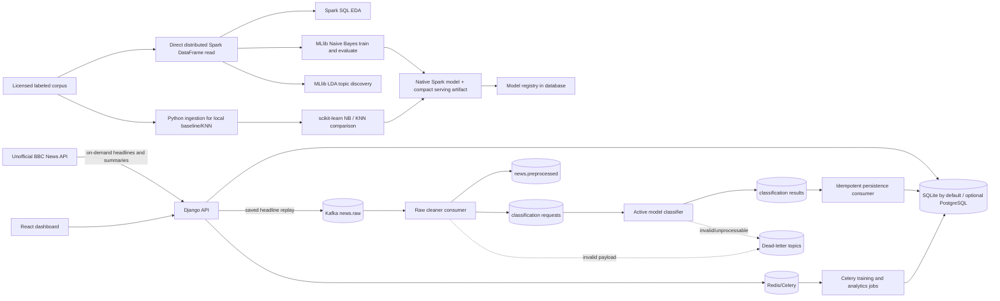

# Architecture and data flow

## Components

## Data boundaries

The live upstream provides current headline metadata and summaries, not guaranteed full article text. `LiveNewsItem` keeps its source URL, title, summary, image, sections, language and fetch snapshot time. It does not infer a publication time. Kafka messages use a stable BBC-link-derived document ID and snapshot-derived event ID. The event timestamp is when this application publishes the message.

Historical supervised labels come from the supplied labeled dataset. For Spark jobs, `bigdata.spark.data.read_articles` reads the source CSV or the five category folders into a Spark DataFrame; article content is not collected into Python objects on the driver. Spark SQL aggregates class/length/vocabulary statistics and returns only aggregate values and bounded top-term lists to the dashboard/CLI. The standard Python EDA and scikit-learn paths remain available for smaller corpora and comparison.

The distributed classifier uses Spark MLlib's tokenization, stopword removal, CountVectorizer, IDF, ChiSqSelector (or a variance-based VectorSlicer), and Multinomial Naive Bayes. The train/test split and CV folds are explicitly ranked within each category. All fitted text transformations and selectors are learned from their respective training folds only, avoiding vocabulary/IDF/selection leakage. It records macro and per-class test metrics and stores the native Spark pipeline model plus a compact inference artifact. That inference artifact serves API/Kafka predictions without starting a Spark context per request. scikit-learn KNN is retained as a comparison because it is not a native standard Spark MLlib estimator.

MLlib LDA is a distinct unsupervised branch. It consumes nonnegative document-term counts, not TF-IDF values, stores topic-term summaries, persists the native model, and writes per-document topic vectors as Parquet rather than collecting the full output to the driver. This provides document topic features for analytics; the current supervised classifier does not yet concatenate LDA distributions with TF-IDF.

For live summaries, the selected registered classifier predicts one of its trained categories. That predicted category is an application inference and is stored as a Kafka-origin Prediction, separate from the upstream sections.

## Kafka stages and reliability

The backend creates the eight configured topics with three partitions and replication factor one for local development. `news.raw` events are size-checked and restricted to HTTPS BBC hosts. The raw consumer cleans text, emits a preprocessed event and a classification request. The classifier loads the currently active model artifact and emits probabilities, confidence, latency, content hash and model version. The results consumer stores predictions with the event ID as a unique key, making result replay idempotent.

Consumers disable automatic offset commits. A successfully handled event is committed after downstream acknowledgments; a rejected/unprocessable payload goes to a dead-letter topic and is then committed. If dead-letter delivery itself fails, the source offset remains uncommitted. Local topic replication is one, so this setup is for development and does not provide broker fault tolerance.

## Background work

Django API requests enqueue scikit-learn or Spark MLlib classifier training and Spark MLlib LDA through Celery/Redis. The model training workflow stores metrics, confusion matrices and serving artifacts; Spark classifier runs also save the native Spark PipelineModel. The user registers a successful experiment and explicitly activates a version. Predictions use that active version. The app defaults to SQLite for a low-friction local start; PostgreSQL is available in Compose for a more representative multi-process database setup.
